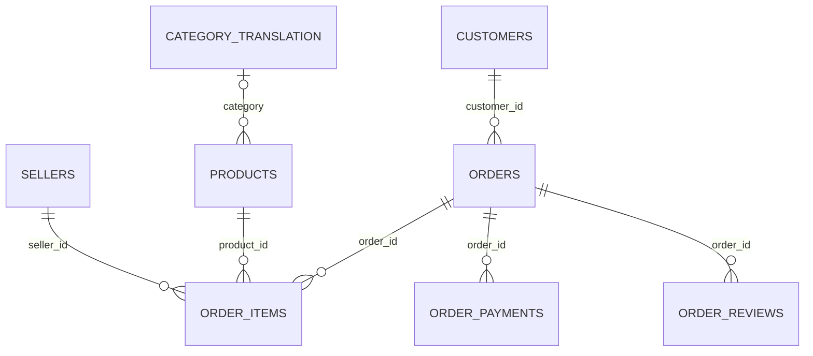

# 数据模型与字段约定

## 原始层

CSV 保留在 `data/raw/`，导入清单记录文件名、SHA-256 和行数。数据库的 `raw_*` 为类型化源数据副本：空 CSV 单元格转为 NULL、数字与日期按明确类型转换，其他文本不改写。原始 CSV 才是逐字节证据；不要把类型化表称为完全无损的文件存档。

每个 raw 表增加自增 `raw_row_id` 作为物理主键，允许源业务键重复。质量脚本检查真正的业务键，并在产生重复金额前阻止建视图/分析。关键 ID 使用二进制排序规则，避免大小写合并。

| 表 | 预期业务键 | 常用关联 |
| --- | --- | --- |
| raw_orders | order_id | customer_id |
| raw_customers | customer_id | customer_unique_id 标识跨订单自然人 |
| raw_order_items | order_id + order_item_id | order_id、product_id、seller_id |
| raw_order_payments | order_id + payment_sequential | order_id |
| raw_order_reviews | 不假定 review_id 或 order_id 唯一 | order_id |
| raw_products | product_id | product_category_name |
| raw_sellers | seller_id | seller_state |
| raw_category_translation | product_category_name | 英文品类 |
| raw_geolocation | 无唯一邮编前缀业务键 | 本版不直接 JOIN |

商品字段 `product_name_lenght`、`product_description_lenght` 保留源文件拼写。INT 接受 `40` 和数值等价的 `40.0`，拒绝 `40.5`。金额使用 `DECIMAL(14,2)`，拒绝静默四舍五入；地理坐标使用 DOUBLE，不参与金额计算。邮编前缀用字符串存储，保留源文件已有的前导零；不猜测补齐源数据。

## 源表逻辑关系

下图是通过质量校验后预期成立的逻辑关系；raw 表不强制声明这些外键，以便保留并审计源数据问题。客户与订单按逻辑可一对多；实际数据中的 `customer_id` 通常更接近订单客户记录，复购分析应使用 `customer_unique_id`。

## 可复用层

| 视图 | 一行代表 | 实现策略 |
| --- | --- | --- |
| v_reviews_latest | 一笔有评价的订单 | ROW_NUMBER 按答复时间、创建时间、review_id、源行号倒序取 1 |
| v_order_fact | 一笔订单，包含所有状态 | 明细、支付分别聚合后再 JOIN；关联最新评价及客户州 |
| v_order_category | 一笔订单中的一个归一化品类 | 明细先关联商品/映射，再按订单与品类聚合 |

评价排序中 NULL 时间排在非空时间之后；完全相同时依赖固定文件导入顺序确定 `raw_row_id`。这是确定性规则，不意味着业务上能识别“最终真实评价”。同一源文件重导后的自增起点变化不会改变相对行序。

品类优先使用英文名，无映射时使用 `pt:原葡语名`，缺失时使用 `unknown`。因此不会因缺失翻译而丢掉 GMV。

### 为什么不能直接关联所有表

若一单有 2 条商品和 2 条支付，直接 JOIN 会产生 4 行。此时商品金额与支付金额都可能翻倍。`v_order_fact` 先把两边聚合成每单一行，金额守恒检查再核对：

- 原始商品 SUM(price) = 订单视图 SUM(item_gmv)。
- 原始商品 SUM(freight_value) = 订单视图 SUM(freight_value)。
- 原始支付 SUM(payment_value) = 订单视图 SUM(payment_value)。
- 品类视图商品金额 = 原始商品金额。
- 订单视图行数 = 原始订单行数 = 视图 distinct order_id 数。

商品金额加运费**不要求**等于支付金额：两者定义不同，差异按订单审计并列为 WARN。不能为了对齐金额而修改数据。

## 质量闸门

`FAIL` 包括空核心表、重复业务键、空键、孤立外键、缺失购买时间、非法状态/金额/评分及关联金额不守恒。任何 FAIL 都阻止生成业务结果。

`WARN` 包括多次评价、缺失配送/审批时间、异常时间顺序、未映射品类、缺失地区、已交付无明细和支付对账差异。WARN 不自动删除记录；各指标通过明确的 eligibility 条件决定分母，报告保留检查数量。

本版所有表属于一个专用分析数据库。不要在导入、建视图、分析、优化实验期间并发写入；分析查询使用一致性快照，但此前的质量闸门和建视图不属于同一个只读快照。
